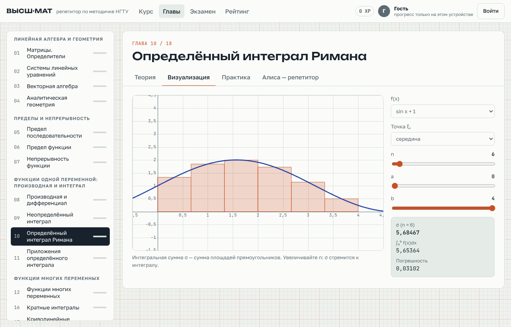

# Репетитор «В гостях у высшей математики»

Веб-приложение для подготовки по высшей математике по методичке А. А. Нуятова
(НГТУ им. Р. Е. Алексеева, 2025).



- 18 глав: теория, пункты «Важно», интерактивный график к каждой главе.
- 54 типа задач со случайными числами и автопроверкой, пробный экзамен на время.
- Регистрация и вход по логину и паролю, прогресс хранится на сервере и
  синхронизируется между устройствами, общий рейтинг.
- Работает в любом браузере на компьютере и телефоне, ставится как приложение (PWA)
  и открывается без интернета. Прогресс, набранный офлайн, отправляется на сервер,
  когда связь возвращается.
- Гостевой режим без регистрации (прогресс только на устройстве; при регистрации
  переносится в аккаунт).
- Алиса — ИИ-репетитор на Claude API (необязательно, нужен ключ).

## Запуск на своём компьютере (сервер — ваш ПК)

Компьютер работает сервером, а студенты заходят по ссылке из интернета —
без хостинга и настройки роутера. Ссылку даёт бесплатный туннель Cloudflare.

1. Установите [Node.js](https://nodejs.org/ru/download) (LTS).
2. Скачайте папку `math-tutor` (на GitHub: Code → Download ZIP, ветка `math-tutor`).
3. Запустите двойным щелчком:
   - Windows — `start-windows.bat`;
   - macOS — `start-mac.command` (при первом запуске: правый щелчок → «Открыть»);
   - Linux — `./start-linux.sh`.
4. В окне появится ссылка вида `https://….trycloudflare.com` — её и раздайте студентам.

Важно:
- сайт работает, пока компьютер включён и окно программы открыто;
- ссылка меняется при каждом запуске. Чтобы не рассылать её вручную, заполните
  `TELEGRAM_BOT_TOKEN` и `TELEGRAM_CHAT_ID` в `settings.env` — ссылка будет сама
  приходить в вашу Telegram-группу;
- аккаунты и прогресс хранятся на вашем компьютере в `data/db.json` — делайте копию;
- настройки (ключ для Алисы, Telegram, порт): скопируйте `settings.example.env`
  в `settings.env` и заполните;
- для постоянного адреса нужен свой домен и именованный туннель Cloudflare
  (бесплатный аккаунт) либо хостинг — см. ниже.

## Как включить ИИ-помощника Алису

1. Зарегистрируйтесь на https://console.anthropic.com, пополните баланс и создайте
   API-ключ (начинается с `sk-ant-`).
2. Скопируйте `settings.example.env` в `settings.env` и впишите ключ:
   `ANTHROPIC_API_KEY=sk-ant-...`
3. Перезапустите программу — в окне появится «Алиса: включена».

### Бесплатно на своём компьютере (Ollama)

Без ключа Claude Алиса может работать на локальной модели. Нужна видеокарта
от 6 ГБ памяти (на процессоре тоже работает, но медленно).

1. Установите [Ollama](https://ollama.com/download).
2. Скачайте модель: `ollama pull qwen2.5:7b`.
3. В `settings.env` впишите `OLLAMA_MODEL=qwen2.5:7b` (строку `ANTHROPIC_API_KEY` оставьте пустой).
4. Перезапустите программу — в окне появится «Алиса: включена, Ollama qwen2.5:7b».

Локальная модель слабее Claude: объясняет и подсказывает неплохо, но в длинных
выкладках может ошибаться.

Что умеет Алиса:
- кнопка «Спросить Алису» в правом нижнем углу на любом экране (или Alt+A): открывает
  чат сбоку и знает, где находится студент — глава, вкладка, текущая задача;
- чат по текущей главе (вкладка «Алиса — репетитор»), история сохраняется на устройстве;
- кнопка «Подсказка» в задаче — наводящий шаг без ответа (верный ответ после
  подсказки даёт 5 XP вместо 10);
- «Спросить Алису, где ошибка» после неверного ответа и «Объяснить подробнее» после верного.

На экзамене Алиса недоступна. Каждый вопрос оплачивается по тарифам Claude API;
на одного студента — не больше 40 вопросов в час. Ключ хранится только на сервере,
студенты его не видят.

## Запуск вручную

Нужен Node.js 20+.

```bash
cd math-tutor
npm install        # ставит только SDK Claude для Алисы; без него всё остальное работает
npm start          # http://localhost:3000
```

## Настройки (переменные окружения)

| Переменная | По умолчанию | Назначение |
|---|---|---|
| `PORT` | `3000` | порт |
| `HOST` | `0.0.0.0` | адрес |
| `DATA_DIR` | `./data` | где хранится `db.json` (пользователи, сессии, прогресс) |
| `ANTHROPIC_API_KEY` | — | ключ Claude API; без него Алиса выключена |
| `CLAUDE_MODEL` | `claude-opus-5-5` | модель для Алисы |
| `COOKIE_SECURE` | — | `1` — всегда ставить cookie с флагом Secure (за HTTPS это определяется автоматически по `X-Forwarded-Proto`) |
| `TRUST_PROXY` | — | `1` — брать IP клиента из `X-Forwarded-For` (для ограничения попыток входа за прокси) |

## Развёртывание

**Docker:**

```bash
docker build -t math-tutor .
docker run -d -p 3000:3000 -v math-tutor-data:/data \
  -e ANTHROPIC_API_KEY=sk-ant-... --name math-tutor math-tutor
```

**Хостинг (Render, Railway, Fly.io, VPS):** команда запуска `npm start`, подключите
постоянный диск и укажите его в `DATA_DIR`, иначе база пропадёт при перезапуске.

Для телефонов нужен HTTPS (установка как приложение и офлайн-режим работают только
по HTTPS). На VPS поставьте перед сервером nginx или Caddy с сертификатом и задайте
`TRUST_PROXY=1`.

## Данные и безопасность

- Пароли хранятся только как хеш scrypt с солью; сессия — случайный токен в
  cookie `HttpOnly; SameSite=Lax`, на сервере лежит только его SHA-256.
- Ограничения: 20 попыток входа/регистрации за 10 минут с одного IP, 40 вопросов
  Алисе в час на пользователя.
- Вся база — один файл `DATA_DIR/db.json` (атомарная запись). Для резервной копии
  достаточно копировать его. Такое хранилище рассчитано на один процесс и сотни —
  тысячи пользователей; для большего масштаба замените его на PostgreSQL/SQLite.
